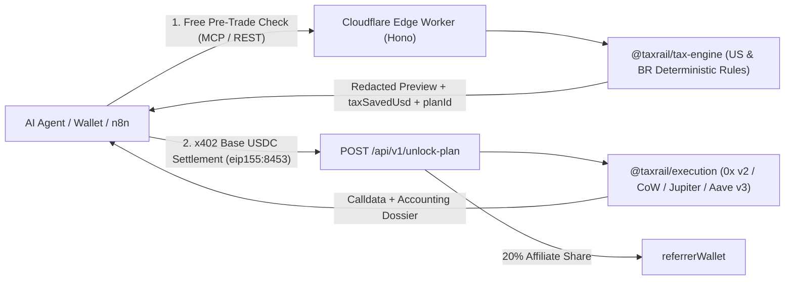

# TaxRail

[](https://glama.ai/mcp/servers/SamuelAguiar12/taxrail)
[](https://glama.ai/mcp/connectors/online.taxrail.api/tax-rail)

**The Autonomous $0-Upfront Tax-Optimization Rail for Humans & AI Agents — US & Brazil**

TaxRail is a non-custodial, deterministic pre-execution tax & treasury optimization layer built for traders, corporate treasuries, and autonomous AI agents. Before executing a swap, TLH rotation (`ETH → wstETH`), or liquidity borrow (`Aave v3`), TaxRail simulates the tax impact across US (`IRS 1099-DA`, `Form 8949`) and Brazilian (`Lei 14.754`, `DeCripto`, `R$ 35k`, `Lucro Real`) regimes, builds ready-to-sign 1-click execution payloads (`0x v2`, `Jupiter`, `Aave v3` atomic batch), and collects **exactly 10% of verified tax savings directly from the operation's proceeds ($0 upfront)** — with **x402 Base USDC** (`eip155:8453`) available as a dossier-only fallback via **Coinbase CDP** and **PayAI**.

---

## Why TaxRail

- **Zero Blind Tax Drag:** Naive FIFO disposals and unoptimized liquidations routinely leak **15%–37%** in avoidable capital gains and indirect taxes. TaxRail sits directly in the pre-trade path.
- **Deterministic Engine, Zero LLM Math:** All lot selection (FIFO vs. HIFO/SpecID), Tax-Loss Harvesting (TLH), Brazil Lei 14.754 / R$ 35k exemptions, and Lucro Real / Simples shields run in deterministic TypeScript—reproducible, auditable, and sub-5ms.
- **Non-Custodial by Design:** TaxRail never holds user funds or private keys. It outputs unsigned swap intents and Aave v3 calldata for the agent or user wallet to sign.
- **Agent & Human 1-Click Monetization ($0 Upfront):** Free discovery tools + exact **10% verified-savings fee paid directly from the swap output (`0x v2` / `Jupiter` up to 1000 bps) or `Aave v3` borrowed USDC**, with **20% automatic affiliate revenue share** (`referrerWallet`) and x402 fallback.

---

## Architecture



### Monorepo Layout

| Package / Path | Role |
| :--- | :--- |
| `packages/shared` | Canonical TypeScript types (`types.ts`) and Zod schemas (`schemas.ts`) |
| `packages/tax-engine` | Deterministic US & Brazil tax calculation, lot selection, TLH & Borrow-vs-Sell engine |
| `packages/execution` | Non-custodial payload builders (`0x_v2`, `cow_swap`, `jupiter`, `aave_v3`) & accounting dossiers |
| `packages/mcp-cli` | Local stdio MCP server (`taxrail-mcp`) |
| `packages/agent-plugins` | Coinbase AgentKit `ActionProvider`, LangChain structured tools, and declarative n8n node spec |
| `packages/python-sdk` | Zero-dependency Python SDK (`pip install taxrail`) with OpenAI, LangChain & CrewAI wrappers |
| `apps/edge-worker` | Cloudflare Workers + Hono API, remote `/mcp` endpoint, and `@x402/hono` payment gating |
| `scripts/export-revenue-ledger.ts` | Base USDC ledger -> BRL PTAX converter & Simples Nacional (Fator R / PGDAS-D) exporter |

---

## $0-Upfront 1-Click Pricing Model (10% Paid From Operation)

TaxRail aligns incentives with verifiable savings: **if you save $0 in taxes, the plan costs $0. If you save taxes, you pay $0 out of pocket upfront — TaxRail collects exactly 10% of `taxSavedUsd` directly inside the operation.**

| Step | Tools / Endpoints | Upfront Cost | What You Get |
| :--- | :--- | :---: | :--- |
| **Step 1: Free Discovery** | `check_tax_impact`<br>`compare_borrow_vs_sell`<br>`classify_deductible_expense` | **$0** | Baseline vs. optimized tax (`baselineTaxUsd`, `optimizedTaxUsd`, `taxSavedUsd`), `DynamicPricingQuote`, compliance warnings, and `planId`. |
| **Step 2A: 1-Click Execution (Swaps & Aave v3)** | `prepare_execution`<br>(`POST /api/v1/prepare-execution`)<br>→ sign tx → `claim_dossier`<br>(`POST /api/v1/claim-dossier`) | **$0 upfront**<br>(10% of `taxSavedUsd` paid from swap output / Aave borrow) | Live `0x v2` / `Jupiter` swap calldata (up to `1000 bps` / 10%) or `Aave v3` `atomicBatchCalls` (borrowing `liquidity + 10% fee`), plus on-chain receipt verification unlocking full `SelectedLotDisposal[]`, `TlhOpportunity[]`, and `AccountingDossier` (`IRS_FORM_8949`, `BR_LEI_14754` / `DeCripto`). |
| **Step 2B: Dossier-Only x402 Fallback** | `unlock_tax_plan`<br>(`POST /api/v1/unlock-plan`) | **10% of `taxSavedUsd`**<br>via Base USDC (`x402`) | Direct dossier unlock for non-onchain corporate expenses (`QUICKBOOKS_EXPENSE`, `BR_LUCRO_REAL_OMIE_SPED`) or agents preferring upfront Base USDC settlement. |

### Native On-Chain Fee Mechanics & 20% Affiliate Share

1. **Swaps (`0x v2` EVM / `Jupiter` Solana):** TaxRail embeds `embeddedSwapFeeBps` / `embeddedSwapFeePpm` (up to `1000 bps` / `10%` of trade) directly in the `0x v2` or `Jupiter` quote so 100% of the 10% savings fee is collected from the swap's output token (`USDC`, `wstETH`, `cbETH`, etc.) in 1 transaction.
2. **Aave v3 Borrow-vs-Sell:** `buildAaveBorrowPayload` adds the 10% savings fee on top of `liquidityNeededUsd` (`totalBorrowAmountUsd = netLiquidityUsd + feePaidFromBorrowUsd`) and builds `atomicBatchCalls` (`approve` → `supply` → `borrow` → `USDC.transfer`), so the user keeps 100% of their requested liquidity and pays $0 out of pocket.
3. **20% On-Chain Affiliate Share (`affiliateShareUsd`):** Pass `referrerWallet` (or `?ref=0xWallet` on `taxrail.online`) to automatically receive **20% of TaxRail's 10% fee** natively inside the `0x v2` multi-recipient split or `Aave v3` USDC transfer.

---

## Supported Jurisdictions & Regimes

- **United States (`US`):** `INDIVIDUAL`, `LLC_PASS_THROUGH`, `C_CORP`
  - Short-term vs. long-term capital gains, 3.8% NIIT toggle, HIFO/SpecID lot selection, Tax-Loss Harvesting, Aave v3 Borrow-vs-Sell interest tax-shield modeling, and `IRS_FORM_8949` / `QUICKBOOKS_EXPENSE` exports.
- **Brazil (`BR`):** `PF_LEI_14754`, `PF_DOMESTIC`, `PJ_LUCRO_REAL`, `PJ_SIMPLES_EXPORT`
  - Lei 14.754 (15% offshore/crypto flat rate & loss carryforward), PF domestic R$ 35k/month sales exemption check, PJ Lucro Real IRPJ/CSLL + PIS/COFINS + IBS/CBS readiness credits, IOF/FX spread analysis, and `BR_LEI_14754` / `BR_LUCRO_REAL_OMIE_SPED` dossiers.

---

## Quickstart

### 1. Local MCP Server (`stdio`)

```bash
npx -y taxrail-mcp
```

Add to Claude Desktop, Cursor, or any MCP-compatible agent runtime:

```json
{
  "mcpServers": {
    "taxrail": {
      "command": "npx",
      "args": ["-y", "taxrail-mcp"]
    }
  }
}
```

### 2. Remote MCP & REST API (Cloudflare Edge Worker)

- **Remote MCP:** `POST https://api.taxrail.online/mcp`
- **Portable Agent Skill (`SKILL.md`):** `https://api.taxrail.online/SKILL.md` (committed in [`skills/taxrail-crypto-tax/SKILL.md`](skills/taxrail-crypto-tax/SKILL.md) for OpenClaw/ClawHub, Claude Code, Codex, Cursor)
- **REST Endpoints:**
  - `GET /api/v1/x402/pre-trade-check?walletAddress=0x...&sellAsset=ETH&sellAmount=1` (**$0.01 USDC** pre-swap HIFO savings, 366-day ST→LT cliff warning & Aave v3 borrow-vs-sell check via x402)
  - `GET /api/v1/x402/br-35k-status?monthlySalesBrl=20000&plannedSaleUsd=2500&custodyLocation=DOMESTIC` (**$0.005 USDC** Brazil R$35k monthly domestic exemption vs Lei 14.754 flat 15% check via x402)
  - `GET /api/v1/x402/tlh-scan?walletAddress=0x...&chain=base&asset=ALL` (**$0.01 USDC** 1-parameter multi-asset wallet TLH & tax-risk scanner covering up to 25 volatile tokens via x402, with per-token `planId`s)
  - `POST /api/v1/x402/optimize` (**$0.10 USDC** 1-step full optimization + calldata + dossier via x402)
  - `POST /api/v1/check-tax-impact` (Free preview -> 1-click `prepare-execution` or `unlock-plan`)
  - `POST /api/v1/borrow-vs-sell` (Free preview -> 1-click `prepare-execution` or `unlock-plan`)
  - `POST /api/v1/classify-expense` (Free preview -> `unlock-plan`)
  - `POST /api/v1/prepare-execution` (**$0 upfront** — returns `0x v2` / `Jupiter` / `Aave v3` batch with 10% fee from operation)
  - `POST /api/v1/claim-dossier` (Verifies on-chain receipt by `txHash` and unlocks SpecID lots + Form 8949 / DeCripto CSV)
  - `POST /api/v1/unlock-plan` (Dynamic x402 `USDC` fallback on `eip155:8453`, 10% of verified tax savings)
  - `POST /api/v1/feedback` & `GET /api/v1/reputation` (Free agent feedback loop & BaseScan-verified public reputation)

### 3. Coinbase AgentKit & SDK (`npm install taxrail-agent-tools`)

```ts
import { TaxRailActionProvider } from "taxrail-agent-tools";

const taxRail = new TaxRailActionProvider({
  baseUrl: "https://api.taxrail.online",
  referrerWallet: "0xYourDeveloperWalletOnBase", // earns 20% affiliate share
});

const actions = taxRail.getActions();
```

### 4. LangChain Tools

```ts
import { DynamicStructuredTool } from "@langchain/core/tools";
import { createTaxRailLangChainTools } from "taxrail-agent-tools";

const tools = createTaxRailLangChainTools({
  baseUrl: "https://api.taxrail.online",
  referrerWallet: "0xYourDeveloperWalletOnBase",
}).map((spec) => new DynamicStructuredTool(spec));
```

### 5. n8n Community Node

Import the declarative node definition from [`packages/agent-plugins/src/n8n-node.json`](packages/agent-plugins/src/n8n-node.json) to run `checkTaxImpact`, `compareBorrowVsSell`, `classifyDeductibleExpense`, and `unlockPlan` inside automated n8n workflows.

---

## Local Development

Requirements: **Node.js 22+** and **pnpm 10+**.

```bash
# Install workspace dependencies
pnpm install

# Typecheck all packages
pnpm typecheck

# Run test suite
pnpm test

# Start the Cloudflare Edge Worker locally
pnpm dev:worker

# Dry-run Cloudflare Workers deployment
pnpm deploy:dry-run

# Export a demo Brazilian CNPJ Service Export revenue report (PTAX + Fator R)
node --experimental-strip-types scripts/export-revenue-ledger.ts --demo --ptax 5.80
```

---

## Documentation (Português)

- [Decisões de Arquitetura (CTO Analysis)](docs/TECH-DECISIONS.md)
- [Roadmap de Execução em 4 Fases](docs/ROADMAP.md)
- [Guia Prático de Compliance Brasil & EUA](docs/LEGAL-BR-US.md)

---

## Disclaimer

TaxRail is a deterministic tax-calculation and non-custodial transaction-routing software layer. It does not provide legal, accounting, or investment advice, nor does it act as a custodian or digital-asset broker. Always have generated dossiers reviewed by a licensed CPA (US) or accountant (Brazil).
