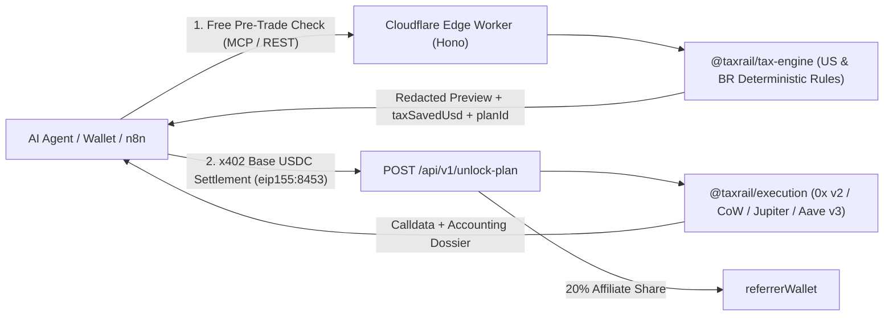

# TaxRail

**The Autonomous Tax-Optimization Rail for AI Agents — US & Brazil**

TaxRail is a non-custodial, deterministic pre-execution tax & treasury optimization layer built for autonomous AI agents, wallets, and fintech workflows. Before an agent executes a swap, borrows liquidity, or pays a corporate vendor, TaxRail simulates the tax impact across US and Brazilian regimes, builds non-custodial execution payloads (`0x v2`, `CoW Swap`, `Jupiter`, `Aave v3`), and settles pay-per-savings fees natively via **MCP × x402** on Base (`eip155:8453` USDC).

---

## Why TaxRail

- **Zero Blind Tax Drag:** Naive FIFO disposals and unoptimized liquidations routinely leak **15%–37%** in avoidable capital gains and indirect taxes. TaxRail sits directly in the pre-trade path.
- **Deterministic Engine, Zero LLM Math:** All lot selection (FIFO vs. HIFO/SpecID), Tax-Loss Harvesting (TLH), Brazil Lei 14.754 / R$ 35k exemptions, and Lucro Real / Simples shields run in deterministic TypeScript—reproducible, auditable, and sub-5ms.
- **Non-Custodial by Design:** TaxRail never holds user funds or private keys. It outputs unsigned swap intents and Aave v3 calldata for the agent or user wallet to sign.
- **Agent-Native Monetization (`MCP × x402`):** Free discovery tools + 10% verified-savings unlock on Base USDC, with **20% automatic affiliate revenue share** for agent developers (`referrerWallet`).

---

## Architecture



### Monorepo Layout

| Package / Path | Role |
| :--- | :--- |
| `packages/shared` | Canonical TypeScript types (`types.ts`) and Zod schemas (`schemas.ts`) |
| `packages/tax-engine` | Deterministic US & Brazil tax calculation, lot selection, TLH & Borrow-vs-Sell engine |
| `packages/execution` | Non-custodial payload builders (`0x_v2`, `cow_swap`, `jupiter`, `aave_v3`) & accounting dossiers |
| `packages/mcp-cli` | Local stdio MCP server (`@taxrail/mcp`) |
| `packages/agent-plugins` | Coinbase AgentKit `ActionProvider`, LangChain structured tools, and declarative n8n node spec |
| `apps/edge-worker` | Cloudflare Workers + Hono API, remote `/mcp` endpoint, and `@x402/hono` payment gating |
| `scripts/export-revenue-ledger.ts` | Base USDC ledger -> BRL PTAX converter & Simples Nacional (Fator R / PGDAS-D) exporter |

---

## 2-Step `MCP × x402` Pricing Model

TaxRail aligns incentives with verifiable savings: **if an agent saves $0 in taxes, the plan costs $0.**

| Step | Tools / Endpoints | Cost | What You Get |
| :--- | :--- | :--- | :--- |
| **Step 1: Free Discovery** | `check_tax_impact`<br>`compare_borrow_vs_sell`<br>`classify_deductible_expense` | **$0** | Baseline vs. optimized tax (`baselineTaxUsd`, `optimizedTaxUsd`, `taxSavedUsd`), `DynamicPricingQuote`, compliance warnings, and `planId`. |
| **Step 2: Verified-Savings Unlock** | `unlock_tax_plan`<br>(`POST /api/v1/unlock-plan`) | **10% of `taxSavedUsd`** (default `feeRatePct: 0.10`, range `0.05–0.15` by tier) | Full `SelectedLotDisposal[]`, `TlhOpportunity[]`, unsigned `SwapIntentPayload` / `AaveActionPayload`, and `AccountingDossier` (`IRS_FORM_8949`, `QUICKBOOKS_EXPENSE`, `BR_LEI_14754`, `BR_LUCRO_REAL_OMIE_SPED`). |

### Hybrid Fee Split & Developer Affiliate Share

1. **Upfront x402 Cap (`upfrontX402Usd`):** Settled atomically in USDC on Base (`eip155:8453`) via HTTP `402 Payment Required`, capped with a **$50 guardrail** (e.g., `$10` upfront + remaining fee shifted to swap calldata).
2. **Embedded Swap Fee (`embeddedSwapFeeBps`):** Remaining fee embedded as a transparent Partner/Integrator fee (`0–100 bps`) directly inside `SwapIntentPayload.feeRecipients`.
3. **Enterprise Balance (`enterpriseBalanceUsd`):** Any excess fee beyond the swap cap is tracked for enterprise settlement.
4. **20% Developer Affiliate Share (`affiliateShareUsd`):** Pass your `referrerWallet` (or configure it once in `agent-plugins`) to automatically receive **20% of TaxRail's total fee**.

---

## Supported Jurisdictions & Regimes

- **United States (`US`):** `INDIVIDUAL`, `LLC_PASS_THROUGH`, `C_CORP`
  - Short-term vs. long-term capital gains, 3.8% NIIT toggle, HIFO/SpecID lot selection, Tax-Loss Harvesting, Aave v3 Borrow-vs-Sell interest tax-shield modeling, and `IRS_FORM_8949` / `QUICKBOOKS_EXPENSE` exports.
- **Brazil (`BR`):** `PF_LEI_14754`, `PF_DOMESTIC`, `PJ_LUCRO_REAL`, `PJ_SIMPLES_EXPORT`
  - Lei 14.754 (15% offshore/crypto flat rate & loss carryforward), PF domestic R$ 35k/month sales exemption check, PJ Lucro Real IRPJ/CSLL + PIS/COFINS + IBS/CBS readiness credits, IOF/FX spread analysis, and `BR_LEI_14754` / `BR_LUCRO_REAL_OMIE_SPED` dossiers.

---

## Quickstart

### 1. Local MCP Server (`stdio`)

```bash
npx @taxrail/mcp
```

Add to Claude Desktop, Cursor, or any MCP-compatible agent runtime:

```json
{
  "mcpServers": {
    "taxrail": {
      "command": "npx",
      "args": ["-y", "@taxrail/mcp"]
    }
  }
}
```

### 2. Remote MCP & REST API (Cloudflare Edge Worker)

- **Remote MCP:** `POST https://api.taxrail.online/mcp`
- **REST Endpoints:**
  - `POST /api/v1/check-tax-impact` (Free)
  - `POST /api/v1/compare-borrow-vs-sell` (Free)
  - `POST /api/v1/classify-deductible-expense` (Free)
  - `POST /api/v1/unlock-plan` (x402 `USDC` on `eip155:8453`)

### 3. Coinbase AgentKit Plugin

```ts
import { TaxRailActionProvider } from "@taxrail/agent-plugins";

const taxRail = new TaxRailActionProvider({
  baseUrl: "https://api.taxrail.online",
  referrerWallet: "0xYourDeveloperWalletOnBase", // earns 20% affiliate share
});

const actions = taxRail.getActions();
```

### 4. LangChain Tools

```ts
import { DynamicStructuredTool } from "@langchain/core/tools";
import { createTaxRailLangChainTools } from "@taxrail/agent-plugins";

const tools = createTaxRailLangChainTools({
  baseUrl: "https://api.taxrail.online",
  referrerWallet: "0xYourDeveloperWalletOnBase",
}).map((spec) => new DynamicStructuredTool(spec));
```

### 5. n8n Community Node

Import the declarative node definition from [`packages/agent-plugins/src/n8n-node.json`](packages/agent-plugins/src/n8n-node.json) to run `checkTaxImpact`, `compareBorrowVsSell`, `classifyDeductibleExpense`, and `unlockPlan` inside automated n8n workflows.

---

## Local Development

Requirements: **Node.js 22+** and **pnpm 10+**.

```bash
# Install workspace dependencies
pnpm install

# Typecheck all packages
pnpm typecheck

# Run test suite
pnpm test

# Start the Cloudflare Edge Worker locally
pnpm dev:worker

# Dry-run Cloudflare Workers deployment
pnpm deploy:dry-run

# Export a demo Brazilian CNPJ Service Export revenue report (PTAX + Fator R)
node --experimental-strip-types scripts/export-revenue-ledger.ts --demo --ptax 5.80
```

---

## Documentation (Português)

- [Decisões de Arquitetura (CTO Analysis)](docs/TECH-DECISIONS.md)
- [Roadmap de Execução em 4 Fases](docs/ROADMAP.md)
- [Guia Prático de Compliance Brasil & EUA](docs/LEGAL-BR-US.md)

---

## Disclaimer

TaxRail is a deterministic tax-calculation and non-custodial transaction-routing software layer. It does not provide legal, accounting, or investment advice, nor does it act as a custodian or digital-asset broker. Always have generated dossiers reviewed by a licensed CPA (US) or accountant (Brazil).
